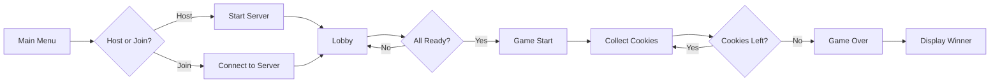

<div align="center">

# 🍪 Cookie Grabber

### *A Real-Time Multiplayer Cookie Collection Game*

[](https://www.python.org/)
[](https://www.pygame.org/)
[](https://en.wikipedia.org/wiki/User_Datagram_Protocol)
[](https://github.com/TechnoMechno/371_Networking_Project)

[Demo Video](#-demo) • [Features](#-key-features) • [Installation](#-installation--setup) • [How to Play](#-how-to-play) • [Tech Stack](#-tech-stack)

</div>

---

## 📋 Table of Contents

- [Overview](#-overview)
- [Demo](#-demo)
- [Key Features](#-key-features)
- [Tech Stack](#-tech-stack)
- [Project Structure](#-project-structure)
- [Installation & Setup](#-installation--setup)
- [How to Play](#-how-to-play)
- [Game Architecture](#-game-architecture)
- [Development Highlights](#-development-highlights)
- [Future Enhancements](#-future-enhancements)
- [Contributing](#-contributing)
- [License](#-license)

---

## 🎯 Overview

**Cookie Grabber** is a fast-paced, real-time multiplayer game where players compete to collect the most cookies from a shared plate. Built with Python and Pygame, this project demonstrates advanced networking concepts, real-time game state synchronization, and event-driven client-server architecture.

The game features:
- **Real-time UDP networking** for low-latency multiplayer gameplay
- **Client-server architecture** with centralized game state management
- **Dynamic cookie spawning** with two cookie types (regular and star cookies)
- **Lobby system** with player ready-up functionality
- **Score tracking** and game-over state management

This project was developed as part of a networking course to demonstrate practical implementation of UDP protocols, socket programming, and distributed systems design.

---

## 🎬 Demo

https://github.com/TechnoMechno/371_Networking_Project/assets/demo_video.mp4

*Watch players compete in real-time to grab the most cookies!*

---

## ✨ Key Features

| Feature | Description |
|---------|-------------|
| 🌐 **Real-Time Multiplayer** | UDP-based networking for instant game state updates |
| 🎮 **Client-Server Architecture** | Centralized server manages game state and validates player actions |
| 🍪 **Two Cookie Types** | Regular cookies (1 point) and Star cookies (3 points) with different spawn rates |
| 👥 **Lobby System** | Pre-game lobby where players can join and ready up |
| 🏆 **Score Tracking** | Real-time score updates and winner declaration |
| 🎨 **Custom UI** | Pygame-based rendering with custom buttons, text boxes, and game elements |
| 🔄 **Dynamic Spawning** | Cookies respawn automatically after being collected |
| 🔒 **Game Session Control** | Prevents joining during active games |
| ⚡ **Low Latency** | UDP protocol ensures minimal delay in multiplayer interactions |

---

## 🛠️ Tech Stack

### **Core Technologies**
- **Python 3.8+** - Primary programming language
- **Pygame 2.0+** - Game development framework and rendering engine
- **UDP Sockets** - Network communication protocol

### **Networking & Architecture**
- **Socket Programming** - Low-level network communication
- **Threading** - Concurrent client and server operations
- **JSON** - Data serialization for network messages
- **Client-Server Model** - Distributed game architecture

### **Libraries & Modules**
```python
pygame          # Game engine and rendering
socket          # Network communication
threading       # Concurrent execution
json            # Message serialization
ipaddress       # IP validation
enum            # Game state management
```

---

## 📁 Project Structure

```
371_Networking_Project/
│
├── 📂 game_code/              # Core game logic and entities
│   ├── config.py              # Game configuration and constants
│   ├── game.py                # Main game loop and logic
│   ├── player.py              # Player entity and behavior
│   ├── cookie_refactored.py   # Cookie entity implementation
│   ├── Plate.py               # Plate/container for cookies
│   ├── menu.py                # Menu system
│   └── ui.py                  # UI components and rendering
│
├── 📂 server2/                # Server-side implementation
│   ├── server_main.py         # Server entry point
│   ├── networking.py          # UDP server networking logic
│   └── GameStateManager.py    # Centralized game state management
│
├── 📂 client2/                # Client-side implementation
│   ├── client_main.py         # Client entry point
│   ├── client_networking.py   # UDP client networking logic
│   ├── client_gameManager.py  # Client-side game state handling
│   ├── render.py              # Rendering engine and asset loading
│   ├── Button.py              # Interactive button component
│   └── TextBox.py             # Text input component
│
├── 📂 Assets/                 # Game assets (images, sprites)
│   ├── cookie.png
│   ├── starcookie.png
│   └── plate.png
│
├── game_main.py               # Main application entry point
├── demo_video.mp4             # Gameplay demonstration
├── Project.pdf                # Project documentation
└── README.md                  # This file
```

### **Key Files Explained**

<details>
<summary><b>Click to expand detailed file descriptions</b></summary>

#### **Server Components**
- **`server_main.py`** - Initializes UDP server, handles player connections, and manages game sessions
- **`GameStateManager.py`** - Maintains authoritative game state, validates actions, and broadcasts updates
- **`networking.py`** - Handles UDP packet processing, message routing, and connection management

#### **Client Components**
- **`client_main.py`** - Client initialization and main game loop
- **`client_networking.py`** - Sends player inputs and receives game state updates
- **`client_gameManager.py`** - Processes server updates and maintains local game state
- **`render.py`** - Renders game objects, UI elements, and handles Pygame display

#### **Game Logic**
- **`game.py`** - Game loop, event handling, and state transitions
- **`player.py`** - Player entity with position, score, and interaction logic
- **`cookie_refactored.py`** - Cookie entity with type, value, and collision detection
- **`Plate.py`** - Container for managing cookie spawning and positions

#### **Configuration**
- **`config.py`** - Game constants including screen dimensions, colors, network settings, and asset paths

</details>

---

## 🚀 Installation & Setup

### **Prerequisites**
- Python 3.8 or higher
- pip (Python package manager)

### **Step 1: Clone the Repository**
```bash
git clone https://github.com/TechnoMechno/371_Networking_Project.git
cd 371_Networking_Project
```

### **Step 2: Install Dependencies**
```bash
pip install pygame
```

### **Step 3: Verify Assets**
Ensure the `Assets/` folder contains:
- `cookie.png`
- `starcookie.png`
- `plate.png`

### **Step 4: Configure Network Settings** *(Optional)*
Edit `game_code/config.py` to customize:
```python
HOST = "0.0.0.0"        # Server IP address
UDP_PORT = 55555        # Server port
SCREEN_WIDTH = 1366     # Game window width
SCREEN_HEIGHT = 768     # Game window height
```

---

## 🎮 How to Play

### **Starting a Game**

#### **Option 1: Host a Game (Server + Client)**
1. Run the main application:
   ```bash
   python game_main.py
   ```
2. Click **"Host Game"** to start a server
3. Wait for other players to join
4. Click **"Ready"** when all players have joined

#### **Option 2: Join an Existing Game**
1. Run the application:
   ```bash
   python game_main.py
   ```
2. Enter the **server IP address** in the text box
3. Click **"Join Game"**
4. Wait in the lobby and click **"Ready"** when prepared

### **Gameplay Instructions**

1. **Objective**: Collect more cookies than your opponents before time runs out

2. **Controls**:
   - **Left Click**: Grab a cookie from the plate
   - **Mouse Movement**: Move your cursor to target cookies

3. **Cookie Types**:
   - 🍪 **Regular Cookie**: Worth **1 point** (common)
   - ⭐ **Star Cookie**: Worth **3 points** (rare)

4. **Winning**: The player with the highest score when all cookies are collected wins!

### **Game Flow**


---

## 🏗️ Game Architecture

### **Network Protocol**

The game uses **UDP (User Datagram Protocol)** for real-time communication:

| Message Type | Direction | Description |
|--------------|-----------|-------------|
| `JOIN_CHECK` | Client → Server | Handshake to verify server availability |
| `PONG` | Server → Client | Confirmation that server is ready |
| `game_in_session` | Server → Client | Rejection if game already started |
| `player_action` | Client → Server | Player input (cookie grab, ready up) |
| `game_state` | Server → Client | Full game state broadcast |

### **Client-Server Workflow**

```
┌─────────────────────────────────────────────────────────┐
│                     CLIENT SIDE                         │
├─────────────────────────────────────────────────────────┤
│  1. Send JOIN_CHECK handshake                          │
│  2. Receive server confirmation                         │
│  3. Render lobby and wait for players                  │
│  4. Send ready status                                   │
│  5. Receive game state updates                         │
│  6. Detect click events → Send to server               │
│  7. Update local display based on server state         │
└─────────────────────────────────────────────────────────┘
                            │
                            ▼
┌─────────────────────────────────────────────────────────┐
│                     SERVER SIDE                         │
├─────────────────────────────────────────────────────────┤
│  1. Listen for JOIN_CHECK requests                     │
│  2. Accept/reject players based on game state          │
│  3. Track player ready status                          │
│  4. Start game when all players ready                  │
│  5. Validate player actions (collision detection)      │
│  6. Update authoritative game state                    │
│  7. Broadcast state to all connected clients           │
└─────────────────────────────────────────────────────────┘
```

### **State Management**

The game uses an enum-based state system defined in `config.py`:

```python
class GameState(enum.Enum):
    LOBBY = 1        # Pre-game waiting room
    PLAYING = 2      # Active gameplay
    GAME_OVER = 3    # Post-game results
```

---

## 💡 Development Highlights

### **Technical Skills Demonstrated**

#### **1. Network Programming**
- Implemented UDP socket communication for low-latency multiplayer
- Designed custom handshake protocol for connection validation
- Handled packet loss and out-of-order delivery inherent to UDP

#### **2. Concurrent Programming**
- Used Python threading for simultaneous client and server operations
- Managed thread-safe communication between network and game logic

#### **3. Game State Synchronization**
- Centralized server authority prevents cheating and desync
- JSON serialization for efficient state transmission
- Client-side prediction and server reconciliation

#### **4. Object-Oriented Design**
- Modular architecture with separate client, server, and game logic
- Reusable UI components (Button, TextBox)
- Entity-component pattern for game objects

#### **5. Real-Time Systems**
- Event-driven architecture for responsive gameplay
- Efficient rendering loop with Pygame
- Delta-time independent game logic

### **Problem-Solving Approaches**

<details>
<summary><b>Challenge 1: Race Conditions in Cookie Collection</b></summary>

**Problem**: Multiple players could grab the same cookie simultaneously due to network latency.

**Solution**: Server-side validation with timestamp-based conflict resolution. The server maintains authoritative state and only the first valid request is honored.

</details>

<details>
<summary><b>Challenge 2: Mid-Game Join Prevention</b></summary>

**Problem**: Players joining during active games caused state corruption.

**Solution**: Implemented `JOIN_CHECK` handshake that returns `game_in_session` message when game state is `PLAYING`.

</details>

<details>
<summary><b>Challenge 3: Cross-Network Play</b></summary>

**Problem**: Local network games couldn't easily extend to internet play.

**Solution**: Configurable `HOST` and `UDP_PORT` in `config.py`, with IP validation and error messaging for connection failures.

</details>

---

## 🔮 Future Enhancements

### **Planned Features**
- [ ] **Power-ups**: Special cookies with temporary abilities (speed boost, steal points, etc.)
- [ ] **Multiple Rounds**: Best-of-3 tournament mode
- [ ] **Leaderboard**: Persistent score tracking across sessions
- [ ] **Spectator Mode**: Allow observers to watch ongoing games
- [ ] **Matchmaking**: Automatic server discovery and lobby creation
- [ ] **Player Avatars**: Customizable player appearance
- [ ] **Sound Effects**: Audio feedback for actions and events
- [ ] **Game Modes**: Time attack, team play, and survival modes

### **Technical Improvements**
- [ ] **TCP Fallback**: Hybrid TCP/UDP for reliable state sync
- [ ] **NAT Traversal**: STUN/TURN server integration for internet play
- [ ] **Database Integration**: Store player stats and match history
- [ ] **Authentication**: User accounts and session management
- [ ] **Anti-Cheat**: Enhanced server-side validation
- [ ] **Performance Metrics**: Latency monitoring and optimization

---

## 🤝 Contributing

Contributions are welcome! Here's how you can help:

1. **Fork the repository**
2. **Create a feature branch**: `git checkout -b feature/amazing-feature`
3. **Commit your changes**: `git commit -m 'Add amazing feature'`
4. **Push to the branch**: `git push origin feature/amazing-feature`
5. **Open a Pull Request**

### **Development Guidelines**
- Follow PEP 8 style guidelines
- Add comments for complex logic
- Test multiplayer functionality with at least 2 clients
- Update documentation for new features

---

## 📄 License

This project is open source and available for educational purposes.

---

## 🙏 Acknowledgments

- **Course**: Networking Fundamentals (COMP 371)
- **Framework**: [Pygame](https://www.pygame.org/) for game development
- **Inspiration**: Classic multiplayer arcade games

---

<div align="center">

### 🍪 Happy Cookie Grabbing! 🍪

**Built with ❤️ by [TechnoMechno](https://github.com/TechnoMechno)**

*If you found this project interesting, please consider giving it a ⭐!*

</div>
